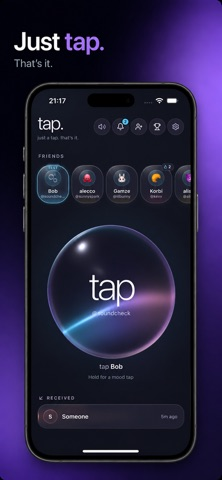
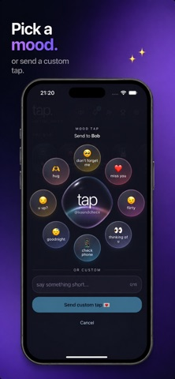
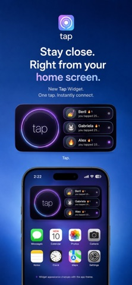

# Product case studies

### Taha Can Atahan · Independent app development

I build consumer apps from product concept through interface design, implementation, and release preparation, using AI-assisted development alongside hands-on iteration and validation. This portfolio focuses on **Tap&Connect**, a published iOS social app, and the architectural decisions behind my wider app projects.

**Production source code is private.** This repository contains public case studies, high-level architecture, and selected product imagery. The applications and their source repositories remain privately maintained.

[Tap&Connect on the App Store](https://apps.apple.com/cz/app/tap-tap-connect/id6778807242) · [GitHub profile](https://github.com/Cnathn)

## Featured: Tap&Connect

**A small interaction, supported by a complete delivery system.** Tap&Connect lets friends send a quick signal of attention, choose a mood, and respond without opening a full conversation. The App Store name is **Tap. | Tap&Connect**.

<table>
<tr>
<td align="center"> <strong>One-tap connection</strong></td>
<td align="center"> <strong>Expressive moods</strong></td>
<td align="center"> <strong>Native widget</strong></td>
</tr>
</table>

*Published App Store marketing imagery; visual presentation can differ from current development builds.*

| Area | What I built and owned |
| --- | --- |
| Product and experience | The lightweight social loop, friend selection, mood taps, onboarding, personalization, and ongoing interaction refinement |
| Application delivery | React and TypeScript interface packaged for iOS with Capacitor; native Swift integrations for platform features |
| Backend | Supabase authentication and data flows, server-side tap handling, and push-notification delivery through Apple Push Notification service |
| iOS experience | WidgetKit/App Intents integration, notification interactions, haptics, and app lifecycle handling |
| Release work | Bundled assets, native builds, release checks, store presentation, and public support/privacy material |

**Stack:** React · TypeScript · TanStack · Tailwind CSS · Capacitor · Supabase/PostgreSQL · Swift · WidgetKit · APNs

The interesting engineering sits behind the simple gesture: separating tap from hold, preserving server-side rules across app and widget, coordinating animation with immediate network dispatch, and handling native lifecycle and advertising SDK behavior.

**[Read the Tap&Connect case study →](case-studies/tap-connect.md)**

## More projects

| Project | Product focus | Technical focus | Release context |
| --- | --- | --- | --- |
| [WagLog / Wag & Waste](case-studies/waglog.md) | Dog routines, observations, trends, and veterinarian reports | Migration from React/Capacitor to SwiftUI, SwiftData, Swift Charts, MapKit, and WidgetKit | Native iOS implementation; public privacy page; App Store availability not verified |
| [Daily Deck](case-studies/daily-deck.md) | Small daily vocabulary sessions | React/TypeScript, Capacitor, local progress, language-specific learning history, and reminders | iOS project and release preparation; public support/privacy pages; App Store availability not verified |
| [Dishwasher Court](case-studies/experiments.md#dishwasher-court) | A spatial puzzle with a courtroom comedy theme | SwiftUI, SpriteKit, placement rules, scoring, and verdict presentation | iOS prototype with public product/support pages |
| [Main Character Court](case-studies/experiments.md#main-character-court) | A daily social game for a friend group | SwiftUI, local sample data, voting flow, and shareable verdict cards | Local MVP |
| [Autopilot Antics](case-studies/experiments.md#autopilot-antics) | Short interactive comedy puzzles | React, TypeScript, explicit game state, and local persistence | Browser prototype |

## How I approach the work

- **Keep the product loop clear.** A tap, a dog-care entry, or a vocabulary session should have an obvious next action.
- **Choose architecture for the experience.** Tap combines a web interface with native extensions; WagLog's current implementation uses native iOS frameworks throughout its main experience.
- **Treat release work as part of development.** Permissions, offline behavior, lifecycle recovery, support pages, and store presentation all affect the finished product.
- **Use AI-assisted development with explicit ownership.** Product direction, trade-offs, integration, and acceptance of the result remain part of my role.

## About this portfolio

The technical summaries were checked against the private project implementations and release notes. Public links and Tap's store listing were checked on **29 September 2026**. Tap's public listing reported version **1.4.4**; later development work is identified separately. No usage, revenue, or performance metrics are claimed here.

See [image sources and usage](assets/README.md). Application source, backend configuration, credentials, and private operational material are not distributed by this repository.
