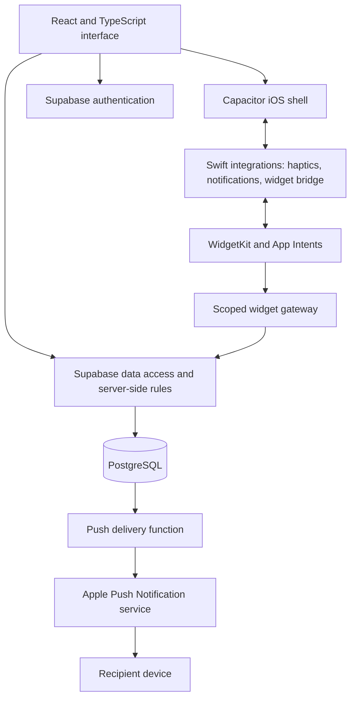
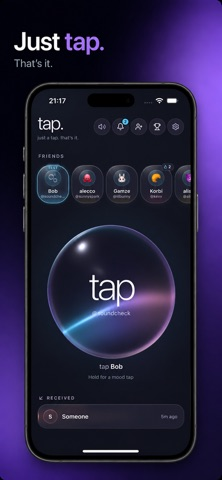
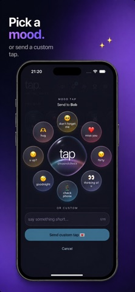
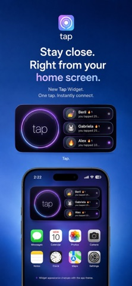

[← Portfolio](../README.md)

# Tap&Connect

### Making a small social gesture feel immediate

**Creator:** Taha Can Atahan 
**Platform:** iOS, with a native Home Screen widget 
**Status:** Published on the App Store; continued private development 
**Source:** Production application and backend code remain private

[App Store](https://apps.apple.com/cz/app/tap-tap-connect/id6778807242) · [Support](https://cnathn.github.io/app-support/tap/support.html) · [Privacy](https://cnathn.github.io/app-support/tap/privacy.html)

## Product

Tap is built around a small social need: acknowledging someone without composing a message or starting a longer conversation. A friend selects a recipient and sends a tap, optionally giving it a mood or short message. Push notifications and a Home Screen widget extend that interaction beyond the main app.

My scope spans product direction, interaction design, AI-assisted implementation, integration of native capabilities, and release preparation. The work combines a deliberately small user-facing action with the supporting account, friendship, notification, and operational flows.

## Architecture

*Conceptual architecture: service responsibilities and interaction boundaries, without deployment details.*

| Layer | Technology | Responsibility |
| --- | --- | --- |
| Interface | React, TypeScript, TanStack, Tailwind CSS | App navigation, friend selection, mood interaction, settings, and feedback |
| iOS shell | Capacitor and Swift | Bundled web experience plus device capabilities and lifecycle integration |
| Native extensions | WidgetKit, App Intents, notification service extension | Home Screen access and notification experiences |
| Backend | Supabase Auth, PostgreSQL, Edge Functions | Identity, social data, controlled actions, and push delivery |
| Visual feedback | WebGL/GLSL, CSS, sound, and haptics | Interactive glass material and coordinated response to gestures |
| Monetization | AdMob rewarded ads and consent handling | Optional rewarded interaction flows within app rules |

## Decisions and challenges

### A web interface with native reach

A React interface supports rapid iteration across the app's screens. Capacitor packages that experience for iOS, while Swift bridges and extensions provide the widget, notification interactions, and device feedback.

The consequence is an integration boundary that needs deliberate attention: native permissions, sessions, app lifecycle events, and extension behavior must remain coherent with the web interface.

### A widget must follow the same product rules

The widget uses a narrowly scoped credential and a server-side gateway. Authorization and the tap operation are handled together on the backend. Quota limits still apply; actions that need the main app direct the user back into it.

This keeps convenience on the Home Screen from becoming a separate set of rules or requiring the full application session in every extension interaction.

### Gesture feedback must not change delivery behavior

A short press sends a tap; holding opens mood selection. The implementation separates those states to avoid accidental sends. More recent development work coordinates the selected mood's visual transition with the send ripple while allowing network dispatch to start immediately.

Reduced-motion behavior and interruption handling are part of the interaction design. The private development notes document focused gesture and animation checks; these are development records, not a claim that every flow has been validated on every device.

### Visual polish still needs operational reliability

The app bundles its fonts, effect artwork, and shader assets so the core visual presentation does not depend on a design CDN. Backend actions and ads still require their online services.

Native release work includes WebView recovery, scene lifecycle handling, deep-link forwarding, consent presentation, and rewarded-ad behavior. These concerns are less visible than the interface, but central to a reliable iOS experience.

## Release and validation context

Tap's public Czech App Store listing reported **version 1.4.4 on 29 September 2026**. The repository also contains **1.4.5 development work**, including friend-dial momentum and mood transitions, whose notes explicitly identify local simulator builds without an App Store Connect upload.

The release process builds and bundles the web assets, synchronizes the iOS project, and uses Xcode archive/export for distribution. Documented checks include static analysis, focused interaction tests, browser and simulator review, and an asset guard. Physical-device push, widget, advertising, and lifecycle checks remain distinct release steps.

**Outcome:** a publicly available app with an integrated backend, push delivery, and native widget, plus an ongoing iteration process. This case study demonstrates delivery scope and architectural reasoning; it does not claim adoption or commercial results.

## Product imagery

These are existing public App Store marketing images, preserved as published. They are product illustrations, not test evidence for the latest development build.
