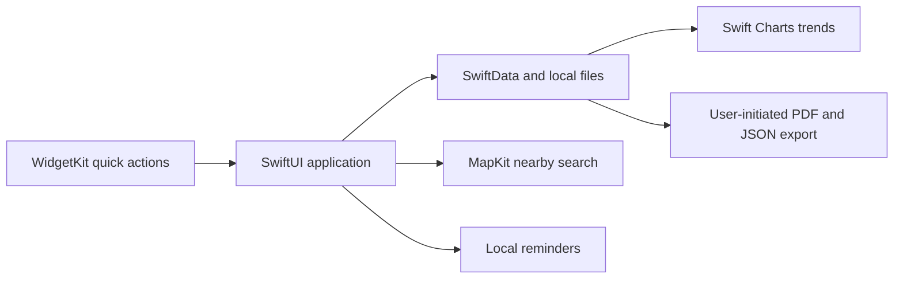
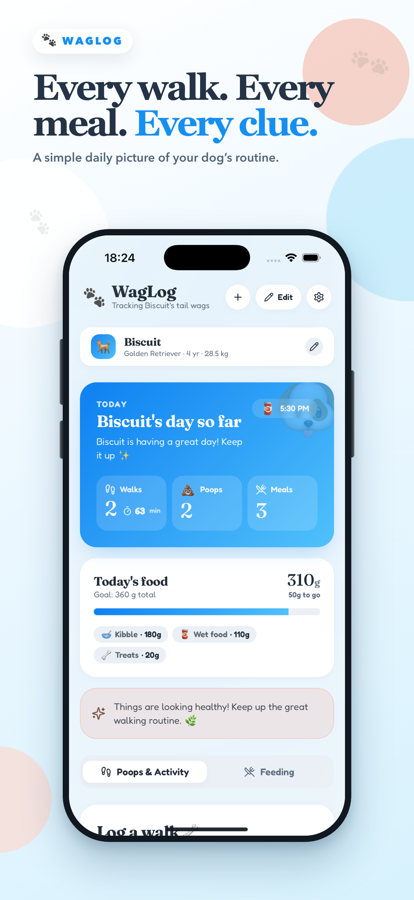
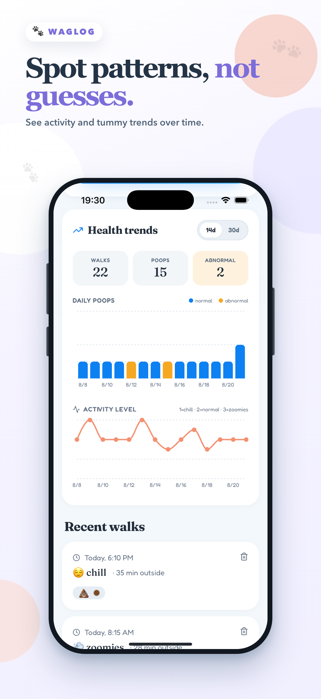

[← Portfolio](../README.md)

# WagLog / Wag & Waste

### A useful daily record for dog owners

**Creator:** Taha Can Atahan 
**Platform:** Native iOS 
**Status:** Native implementation with release preparation; App Store availability not verified 
**Source:** Private

[Public privacy policy](https://cnathn.github.io/waglog-privacy/)

## Product and scope

WagLog helps an owner record walks, meals, and stool observations, review changes over time, and prepare a concise report to share with a veterinarian. The project is maintained under the working repository name **Wag & Waste**; the app is named **WagLog**.

My work covers the product flow, interface, observation model, trends, nearby-place discovery, and release material. Its evolution also includes a substantial architectural change: the current iOS application uses **SwiftUI**, while the original React/Vite/Capacitor implementation remains a design and migration reference.

## Architecture

The native implementation includes multiple dog profiles, detailed observations and optional photos, history, charts, local reminders, App Shortcuts, a Home Screen widget, PDF reporting, and backup/import.

## Decisions and challenges

| Decision | Product reason | Trade-off |
| --- | --- | --- |
| Move the main experience to SwiftUI | Use native navigation, persistence, charts, and platform integrations | Web UI changes must be ported deliberately; they no longer update the native app |
| Keep records on device | Make personal routine tracking useful without an account or app backend | Cross-device access is not presented as an automatic cloud service |
| Request location only for an explicit search | Let owners choose when nearby discovery is useful | Provide a manual city/address alternative when location is unavailable or unwanted |
| Make export user initiated | Turn recorded observations into something an owner can choose to share | Reporting must remain understandable outside the app |
| Use cautious health language | Help organize observations without presenting the app as a diagnosis | Prompts need clear limits and appropriate direction to veterinary care |

The architecture uses SwiftUI, SwiftData, Swift Charts, MapKit, WidgetKit, and App Intents. The current project documentation describes no advertising or analytics SDKs in the native app.

## Release context

The native app targets iOS 17 or later and is built with Xcode and a local Swift package. Earlier Capacitor submission notes and screenshot assets remain in the project history, so they should not be mistaken for the current native release specification.

A public privacy policy is available. A matching public App Store listing was not verified during this portfolio review; this page therefore makes no claim that WagLog is currently downloadable from the store.

## Earlier prototype imagery

**These images show the earlier Capacitor prototype, not the current SwiftUI interface.** The original asset notes date them to 21 August 2026 and identify the dog/activity history as fictional Simulator data. They illustrate the product's design evolution.

**What this project demonstrates:** an app evolving from a web prototype into a native implementation, with explicit choices about local data, useful reporting, and platform integration.
